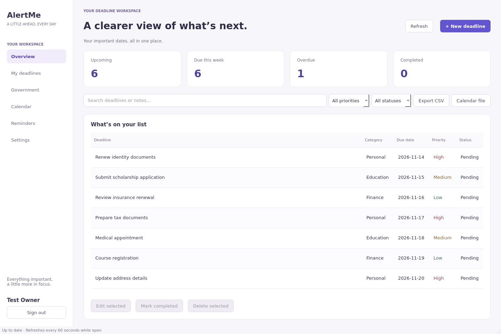
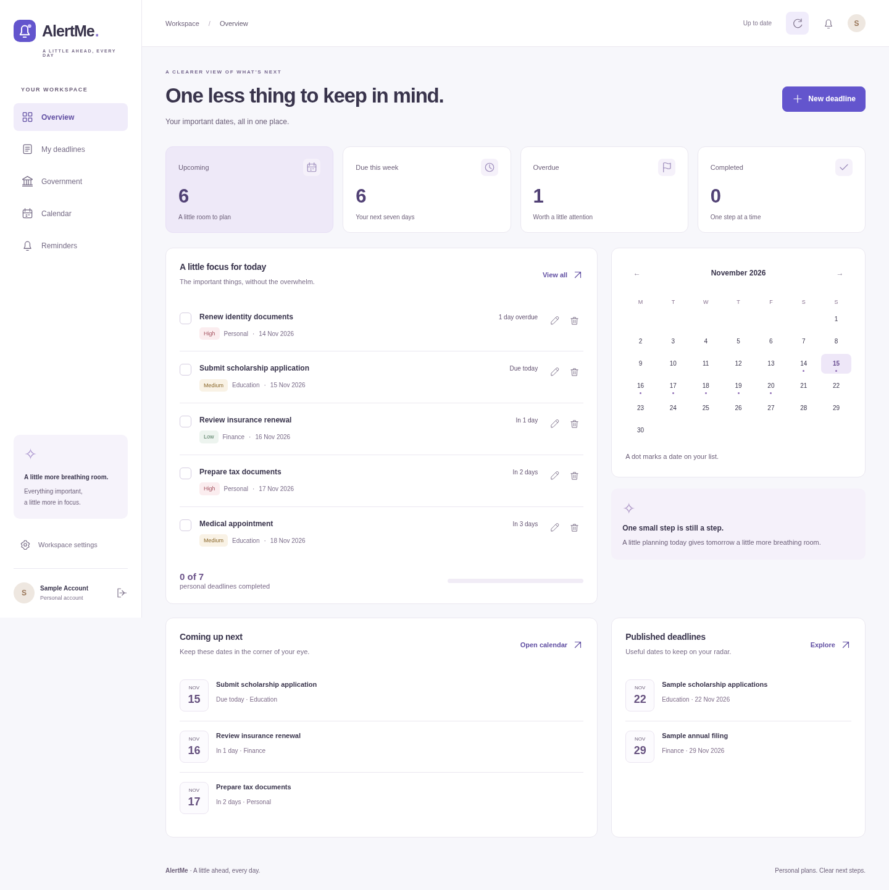
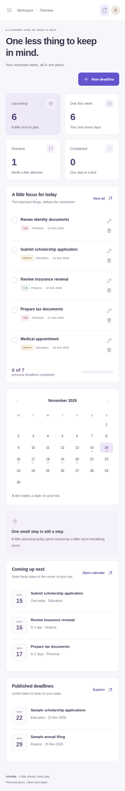
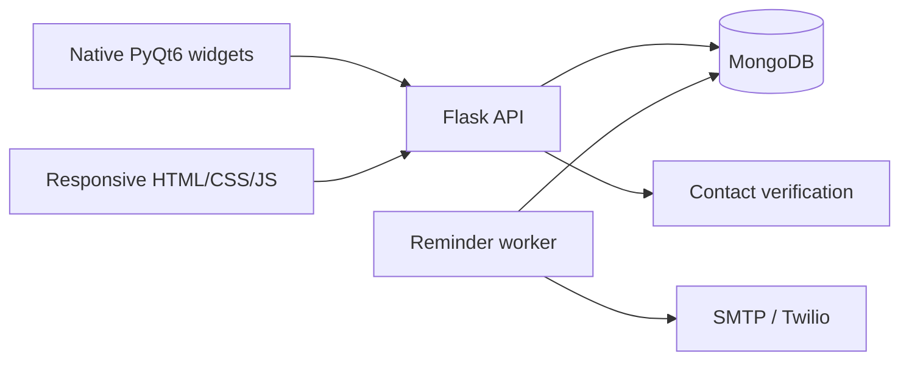

# AlertMe

**A little ahead, every day.** A connected deadline workspace with a **native PyQt6 desktop app** and a **responsive website**, backed by one Flask API and MongoDB.

[](https://github.com/taksh1507/AlertMe-Government-Deadline-Assistant/actions)
[](Alertme/requirements.txt)
[](LICENSE)



## One account. Two ways to stay on track.

The desktop app uses real Qt widgets and asynchronous Qt networking. The website
works on desktop, tablet and mobile browsers. Both connect to the same API, so
changes appear after refresh in either client.

- **Personal deadlines:** create, edit, complete and organize dates by priority,
  category and status, with configurable reminder days.
- **Published deadlines:** administrators publish dates with department details
  and source links. Users follow a deadline to add it to their calendar.
- **Useful views:** upcoming, this-week, overdue and completed counts; searchable
  lists; priority/status filters; and a calendar of personal and followed dates.
- **Portable plans:** export the current filtered list as CSV or an all-day `.ics`
  calendar file, including correctly adjusted end dates.
- **Reminder preferences:** email and SMS verification, opt-in channels, and actual
  delivery-attempt history. A separate worker handles scheduled reminders.
- **Consistent account flows:** signup, sign-in, administrator publishing, contact
  verification, password changes and sign-out on desktop and web.

<details>
<summary>See the website and mobile layout</summary>





Screenshots use synthetic test accounts and example deadlines. They do not imply
affiliation with a government department or availability of actual applications.
</details>

## Run desktop and web locally

Use **Python 3.12+**, MongoDB 8, and a desktop environment for the native app.

```bash
git clone https://github.com/taksh1507/AlertMe-Government-Deadline-Assistant.git
cd AlertMe-Government-Deadline-Assistant
python -m venv .venv
# macOS/Linux: source .venv/bin/activate
# Windows PowerShell: .venv\Scripts\Activate.ps1
python -m pip install --upgrade pip
python -m pip install -r Alertme/requirements.txt
```

Copy `Alertme/.env.example` to `Alertme/.env`. Set `MONGODB_URI`, the database
names, and a unique random `JWT_SECRET_KEY` of at least 32 characters. For example,
generate a value locally with `python -c "import secrets; print(secrets.token_urlsafe(48))"`.
Keep actual environment values out of Git.

Start the shared API and website from the repository root:

```bash
python -m Alertme.src.backend.app
```

Open **http://127.0.0.1:5000** for the website. In another terminal with the same
virtual environment, start the **native desktop app**:

```bash
python Alertme/main.py
```

Create an account in either interface, then sign in from the other. The desktop
uses `ALERTME_API_URL` from `Alertme/.env`; remote API hosts require HTTPS.
No email/SMS account is needed to manage personal deadlines. Delivery features
require the optional provider configuration described below.

For an API/web-only host, install `Alertme/requirements-api.txt` instead of the
full desktop requirements. This connected edition requires the running API.

## GitHub Pages planner

Open [AlertMe online](https://taksh1507.github.io/AlertMe-Government-Deadline-Assistant/).
The Pages edition works without an account: manage personal deadlines, view your
calendar, export CSV/calendar files, and download or restore JSON backups.
Records stay in this browser profile; clearing site data removes them. Keep a
backup to move dates between devices.

GitHub Pages cannot run the API or database. Shared accounts, administrator
publications, subscriptions and email/SMS delivery belong to the connected
edition above. See [deployment instructions](DEPLOYMENT.md) for both editions.

## Publish and follow deadlines

Configure the optional `ADMIN_EMAIL` and `ADMIN_PASSWORD_HASH` on the API host.
Generate a hash locally without putting a plaintext password in a command:

```bash
python -c "from getpass import getpass; from werkzeug.security import generate_password_hash; print(generate_password_hash(getpass('Admin password: ')))"
```

Use **Administrator sign-in**, then publish from Government. Include a useful
source URL so users can check current requirements. A published item is maintained
by the application's administrator; AlertMe does not scrape official portals or
submit applications on the user's behalf.

Regular accounts can follow and unfollow published deadlines. Public lists show
deadline information, not subscriber contact details.

## Enable reminders

1. Set the SMTP and/or Twilio values in `Alertme/.env`. SMS contact verification
   additionally uses `TWILIO_VERIFY_SERVICE_SID`.
2. In Settings, verify the desired contact and enable its reminder channel.
3. Run the worker as a separate process:

```bash
python -m Alertme.src.backend.services.deadline_scanner
# Or scan once for a scheduler/job runner:
python -m Alertme.src.backend.services.deadline_scanner --once
```

The worker uses `APP_TIMEZONE` (default `UTC`) and each deadline's reminder-day
list. It records one attempt per due-date/reminder-day/channel occurrence and
shows sent/failed outcomes in Reminders. Failed attempts are retained for review;
they are not silently reported as delivered or retried without bound. Monitor the
worker and provider account when operating a hosted installation.

The desktop app and website refresh once a minute while open, avoiding active
editing/settings forms. The worker can continue when clients are closed. Native
OS tray notifications, push delivery, offline synchronization and automatic
portal discovery are not implemented.

## Architecture



| Location                             | Responsibility                                              |
| ------------------------------------ | ----------------------------------------------------------- |
| `Alertme/src/frontend/desktop.py`    | Native windows, dialogs, calendar, tables and account flows |
| `Alertme/src/frontend/api_client.py` | Qt event-loop networking with bounded requests              |
| `Alertme/src/web/`                   | Same-origin responsive website and local assets             |
| `Alertme/src/backend/app.py`         | Configured application factory and shared API routes        |
| `Alertme/src/backend/models/`        | Shared validation and retained deadline collections         |
| `Alertme/src/backend/services/`      | Delivery adapters and reminder worker                       |
| `Alertme/src/shared/exporting.py`    | Native CSV and calendar-file formatting                     |

Existing personal records in both configured deadline databases remain visible;
the application does not discard one store when opening the other. Back up an
existing installation before upgrading. See [upgrade notes](DEPLOYMENT.md) for
legacy account indexes and following published deadlines in the new workspace.

## Verification

The integration/native suite requires a **disposable loopback MongoDB**. Set the
following variables before running it (PowerShell: use `$env:NAME="value"`):

```bash
export TEST_MONGODB_URI=mongodb://127.0.0.1:27017
export ALLOW_TEST_DATABASE_RESET=1
python -m pip install -r requirements-test.txt
python -m ruff check Alertme tests
python -m compileall -q Alertme
python -m pytest tests -q
```

Tests reset only their named `_test` databases; never use application data.
The database is real MongoDB so index and concurrency behavior match the API.
Native automation uses Qt's offscreen platform.

Browser tests also require that explicitly disposable MongoDB server:

```bash
npm ci --ignore-scripts
npx playwright install chromium
npm run check:web
npm run test:web
```

Use `PLAYWRIGHT_CHROMIUM_EXECUTABLE` for a system browser and
`ALERTME_TEST_PYTHON` when the test runner needs a specific Python executable.
See [verification notes](docs/VERIFICATION.md) for coverage and recorded results.

[Deployment](DEPLOYMENT.md) · [Contributing](CONTRIBUTING.md) · [License](LICENSE)

Copyright (c) 2025 AlertMe. **Non-commercial use only**, under the existing license.
